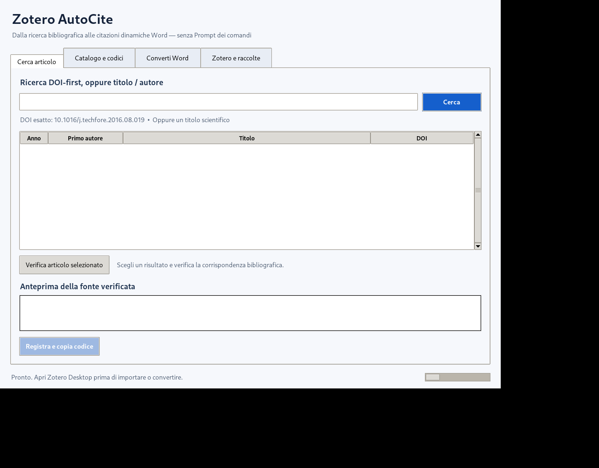

# Zotero AutoCite

**Turn compact citation markers into editable Zotero citations and a Zotero-managed bibliography in Microsoft Word.**

> **Status:** independent, experimental open-source proof of concept — **v0.5 beta**. Not affiliated with or endorsed by Zotero or Digital Scholar. The desktop UI and optional Word macro are not production-grade integrations.



## The problem

A researcher drafts a manuscript using an external reference list or AI-assisted writing, with references represented by short identifiers. Re-inserting dozens of sources one by one into Word through the Zotero citation dialog is repetitive. Zotero's **Refresh** command updates existing Zotero fields; it does not interpret arbitrary text such as `[[Z:06937]]`.

AutoCite introduces a local mapping from a **compact stable alias** to a bibliographic record. The converter resolves each alias against the local Zotero library, optionally imports missing records into a user-selected collection, and writes Zotero-compatible citation fields to a *new* `.docx`. The official Zotero Word plugin is then used to refresh citations and the bibliography.

```text
OpenAlex / Crossref --> local SQLite alias registry --> Zotero Local API
                              |                      |
   [[Z:06937]] in Word -------+----> new .docx with Zotero fields
                                              |
                                  Zotero > Refresh in Word
```

## Example

**Input**

```text
The impact of automation varies across occupations [[Z:06937]].

References
[[ZBIB]]
```

**Output after conversion and Zotero Refresh** (example; actual formatting depends on the document's selected citation style):

```text
The impact of automation varies across occupations (Frey & Osborne, 2017).

References
Frey, C. B., & Osborne, M. A. (2017). The future of employment: How susceptible
are jobs to computerisation? Technological Forecasting and Social Change, 114,
254–280. https://doi.org/10.1016/j.techfore.2016.08.019
```

The code `06937` is **not universal**: it is an alias from one local catalog. Other installations assign their own codes. Never infer what an alias refers to without the associated catalog export.

## Current capabilities

- Search publications by **exact DOI** (OpenAlex, with Crossref metadata checks or fallback) or by title/author via OpenAlex.
- Explicitly review and register bibliographic records; assign persistent markers such as `[[Z:00001]]`.
- Store aliases and metadata locally in SQLite; export a CSV with codes, titles, authors, years, DOI/OpenAlex identifiers, and Zotero keys.
- Select the Zotero destination collection; reuse an existing Zotero item where uniquely identifiable, or request authorized creation when needed.
- Convert recognized markers in `.docx` files into editable `ADDIN ZOTERO_ITEM CSL_CITATION` fields and insert a Zotero bibliography field.
- Preserve unresolved markers and produce CSV/JSON reports (missing, ambiguous, inconsistent, and import errors).
- Provide a Windows Tkinter graphical interface and an **optional, user-installed** Word VBA macro.

## Quick start (Windows)

Requirements: **Python 3.10+**, **Zotero Desktop 10+**, **Microsoft Word desktop + Zotero Word plugin**. Zotero must be running. In Zotero, enable **Settings → Advanced → Allow other applications on this computer to communicate with Zotero**.

```powershell
py -m pip install -r requirements.txt
py -m tkinter
pyw AutoCite_Desktop.pyw
```

You can also associate `.pyw` with **Python (default windowed)** and open `AutoCite_Desktop.pyw` by double-clicking.

1. In **Zotero and collections**, select a **test collection**.
2. In **Search article**, paste an exact DOI (recommended), verify and click **Register and copy code**.
3. Insert the returned marker and `[[ZBIB]]` into a test Word document; save and close it.
4. In **Convert Word**, select the file. Enable import only if you want missing sources created in the selected Zotero collection; then convert.
5. Open the newly created `_Zoterizzato.docx`, click **Zotero → Refresh**, then verify **Add/Edit Citation** and the bibliography. Inspect the accompanying `_LOG.csv`.

For command-line operation and installation details see [Windows setup](docs/INSTALL_WINDOWS.md) and [User workflow](docs/USER_WORKFLOW.md).

## Supported marker syntax

```text
[[Z:00001]]
{(Rossi, 2023); doi:10.1234/example}
{(Rossi, 2023); key:ABCD1234}
[[ZCITE:doi:10.1234/example]]
[[ZCITE:key:ABCD1234]]
[[ZBIB]]
```

`[[ZBIB]]` must occupy its own paragraph. The DOI and key examples here are illustrative, not real records.

## Testing and validation

```powershell
py -m unittest -v
```

**42 offline automated tests passed** on the checked-in v0.5 source at the time of this repository preparation (2026-11-10). Tests use controlled or mocked API responses; they do not test a live Windows Word process in CI.

In a limited user-run test, two markers for the same publication converted into editable Zotero citations, Zotero Refresh generated one bibliographic entry, and a repeat run did not create an additional Zotero item. **This is not a general guarantee of idempotency across all records or environments.** See [Validation evidence](docs/VALIDATION.md).

## Known limitations

- Current conversion writes a **new Word file**, not the document currently open in Word. The optional macro launches that copy-based conversion; it does **not** modify Zotero's Refresh button.
- Multi-citation clusters and narrative citations are not yet supported as single native Zotero fields.
- Headers, footnotes, text boxes, comments, hyperlinks, and paragraphs containing existing Word fields are not generally processed.
- Word field serialization is experimental and may require changes as Zotero evolves.
- Public API metadata may be incomplete, ambiguous or inconsistent; automatic matches must be verified.
- An alias alone is not a portable identifier: share its CSV/catalog mapping when collaborating.

Please use copies of important manuscripts. See the [full limitations](docs/LIMITATIONS.md), [architecture](docs/ARCHITECTURE.md), and [privacy/security notes](docs/SECURITY_PRIVACY.md).

## For Zotero developers

We are looking for feedback, not claiming that Zotero lacks any existing citation-scanning features. See our [technical proposal](docs/ZOTERO_PROPOSAL.md), [forum post draft](docs/FORUM_POST.md), and [related work / differentiation](docs/RELATED_WORK.md).

## License

[MIT](LICENSE) for the AutoCite code in this repository. The Zotero name and trademarks remain with their respective owners. No Zotero binaries or licensed third-party datasets are included.
