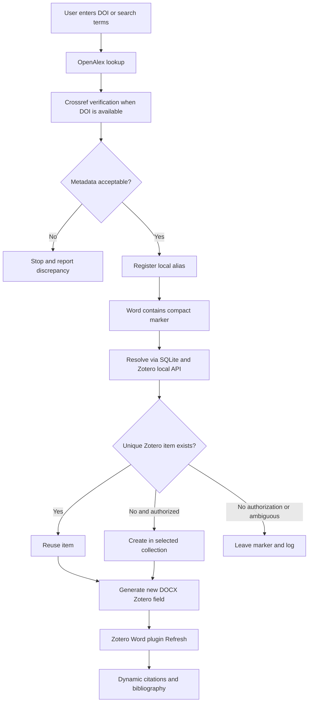

# Technical architecture

## Components

| Component | Responsibility | Main file(s) |
|---|---|---|
| Desktop UI | Searches, catalog browsing, collection selection, conversion | `autocite_desktop.py`, `AutoCite_Desktop.pyw` |
| UI-independent operations | Exact DOI lookup, catalog/export, safe output paths, preflight validation | `autocite_desktop_core.py` |
| External metadata | OpenAlex discovery, Crossref verification | `autocite_openalex.py` |
| Alias registry and Zotero writer | SQLite, deduplication, Zotero local API, collection membership | `autocite_catalog.py` |
| Document conversion | Marker regex, OOXML field injection, bibliography field, reports | `zotero_autocite.py` |
| Optional Word launcher | VBA launches Python on a saved original Word file | `ZoteroAutoCite_Word_05.bas` |

## Identity and persistence

AutoCite assigns a monotonically increasing local integer alias. Data is kept in `%APPDATA%\ZoteroAutoCite\catalogo.sqlite3`, separate from the Zotero database. An alias is mapped to DOI, optional OpenAlex ID, bibliographic metadata, provenance, and when resolved, Zotero server/library/item identifiers. Do **not** publish SQLite or settings files.

A Zotero item key is library-scoped; a local AutoCite alias is catalog-scoped. Neither is a global DOI substitute. The application should eventually support import/export of alias registries with conflict resolution.

## Data flow

## Zotero API details

Zotero Desktop exposes a local API at `http://127.0.0.1:23119/api/` when enabled. Reads are unauthenticated locally; writes (Zotero 10+) require user authorization and a local API key. Item creation uses `POST /api/users/0/items`. Collection association uses a collection key and conditional update. The local API is not a network/public service and should not be exposed externally.

See: https://www.zotero.org/support/dev/web_api/v3/local_api and https://www.zotero.org/support/dev/web_api/v3/write_requests

## Word field strategy

The current converter constructs Zotero-compatible OOXML `ADDIN ZOTERO_ITEM CSL_CITATION` and bibliography fields inside a new `.docx`, plus document preferences. This is an intentionally experimental approach: Word and Zotero may change field formats, and writing fields directly is not a stable public Zotero citation-insertion API. The official Word Zotero add-in later refreshes and validates the fields.

**Open question for Zotero developers:** is there a supported programmatic interface for converting markers *in the currently open Word document* without constructing field XML manually, and for calling the plugin's refresh method safely?

## Safety invariants

- Original `.docx` is not overwritten.
- Import requires a selected and validated personal-library collection and appropriate Zotero authorization.
- Ambiguous matches and metadata conflicts are not silently resolved.
- Unresolved markers remain visible with a machine-readable log.
- Private Zotero catalog data is excluded from this repository.